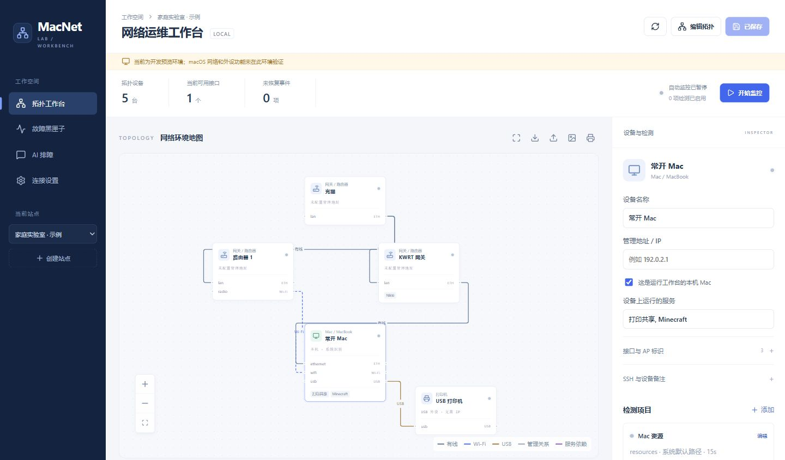
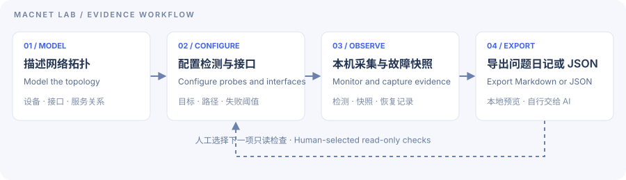
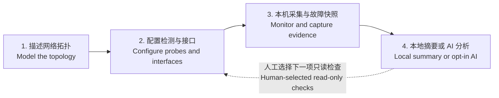

<div align="center">

# 🌐 MacNet Lab

**Visual Network Topology, Interface-Aware Monitoring & Evidence-Driven AI Troubleshooting**<br />
**可视化网络拓扑、接口感知监控与 AI 证据排障工作台**

[](https://github.com/lulouislu/macnet-lab/actions/workflows/checks.yml)
[](LICENSE)
[](#quick-start-en)
[](#roadmap-en)
[](#ai-en)

[简体中文](#zh-cn) · [English](#english) · [使用手册](docs/USAGE_ZH.md) · [Mac 验收清单](docs/MAC_ACCEPTANCE.md)

</div>

---



_开发预览中的示例拓扑，未配置真实网络地址或启用自动检测。 / Development preview with an example topology; no real network targets or automatic probes are configured._

<a id="zh-cn"></a>

## 🇨🇳 简体中文

### 📖 让 AI 先看懂网络，再定位问题

网络出问题时，单独一条 Ping 结果往往解释不了：MacBook 正接在哪个 AP 下？有线与 Wi-Fi 的出口是否不同？手机打印失败，是网络、Mac 的共享服务，还是 USB 打印机的问题？Minecraft 连不上，又是主机资源还是服务响应出了问题？

**MacNet Lab** 用“拼积木”的方式描述网络，把**用户声明的拓扑、当前接入位置、检测路径和故障证据**放在一起，再交给本地摘要或用户选择的 AI 分析。

- **现场维护**：MacBook 接入机房网线或任意一个 AP，从当前位置开展获授权的检测。
- **常驻监控**：常开 Mac 调度已启用的检测，记录故障与恢复。

**单网即可使用，双网不是前提。** 支持描述单 AC 多 AP，也能表达同一台 Mac 的有线、Wi-Fi、USB 接口，以及打印共享和 Minecraft 服务。

> **当前版本：v0.1 开发预览。** 已有可运行程序和跨平台自动化检查。产品目标是 macOS；Linux / Windows 用于通用代码测试和开发预览，不代表它们是已验收的产品平台。真实 Mac 的网卡隔离、Wi-Fi、打印、钥匙串和常驻运行仍待验收。

### ✨ 核心特性

| 模块              | 当前能力                                                                                                |
| ----------------- | ------------------------------------------------------------------------------------------------------- |
| 🧩 拓扑工作台     | 拖拽设备、接口级连线、多站点、JSON 导入导出、PNG 与浏览器打印；区分有线、Wi-Fi、USB、管理关系和服务依赖 |
| 📡 接口感知检测   | ICMP、TCP、DNS、HTTP(S)、显式代理与 Mihomo API；已实现 macOS IPv4 接口绑定，无法绑定时不偷偷回退        |
| 🗺️ 当前接入位置   | 接口、地址与可读取的网关、DNS、Wi-Fi 信息；结合已配置 BSSID 清单关联 AP，不凭 SSID 猜完整网络           |
| 📦 故障黑匣子     | 连续失败阈值、重复事件合并、异常快照、恢复记录、接入变化与采集中断、证据导出                            |
| 🖨️ Mac 托管服务   | CUPS / USB 只读采集、Minecraft Java / Bedrock 状态、主机及指定 PID 的资源信息                           |
| 🔐 凭据与只读 SSH | 系统钥匙串、显式核实的主机公钥、固定命令组；不开放任意 Shell，不自动安装远程探针                        |
| 🧠 AI 证据排障    | 本地规则摘要、实验性 Codex 适配、OpenAI 兼容 API；提供外发预览、明确同意与错误反馈，不静默切换服务商    |

**状态有边界：** 未知、暂停和监控中断不算正常；本机可达不等于其他终端或公网玩家可达。打印状态采集不等于手机发现或实际打印成功；Minecraft 状态不包含未采集的 TPS / MSPT。

### 🏗️ 四步工作流 / Architecture & Workflow



<details>
<summary>Mermaid 版本 / Editable Mermaid diagram</summary>



</details>

1. **拓扑建模**：拖入设备，连接具体接口，为服务补充名称和备注；拓扑是声明，不冒充自动发现结果。
2. **配置检测**：明确目标、端口、源接口、间隔与失败阈值。先手动运行，再按需启用自动监控。
3. **采集与留证**：由运行工作台的 Mac 发起检测；故障达到阈值后保存快照，SSH 补采需另行配置授权。
4. **证据排障**：查看本地摘要，或确认将脱敏证据发送给所选 AI；由用户决定下一步检查。

### 🛠️ 快速开始

准备 **macOS、Python 3.11+、Node.js 22.12+（建议 24）和 Git**：

```bash
git clone https://github.com/lulouislu/macnet-lab.git
cd macnet-lab
bash scripts/install-macos.sh
bash scripts/start-macos.command
```

打开 **[http://127.0.0.1:8765](http://127.0.0.1:8765)**。首次启动的示例不启用网络检测；安装使用项目内 `.venv`，不需要 `sudo`，也不会自动添加登录项。首次构建需要联网下载依赖，日常运行不需要 Node.js。

选择设备 → 添加检测 → **运行一次** → 查看结果。需要持续采集时，再启用检测、保存并点击 **开始监控**。Mac 休眠、退出登录或程序停止时，采集也会中断。

登录常驻、开发预览、备份、接口 DNS 配置与详细限制见 **[使用手册](docs/USAGE_ZH.md)**。当前不提供 Docker Compose 部署或签名的 `.app` / `.dmg` 安装包。

### 🛡️ 安全与 AI 接入

- **本地优先**：仅监听 `127.0.0.1:8765`；拓扑、历史与快照保存在本地 SQLite，凭据进入系统钥匙串。
- **默认不外发**：本地规则摘要不调用模型。云端分析需预览资料并明确同意；API 调用可能产生费用。
- **Codex 独立配置**：安装官方 CLI 后，使用 `.venv/bin/macnet-lab --codex-login` 登录本工具的独立配置。适配器关闭执行类能力并检查外部 MCP 清单；真实账号问答仍待验收。
- **提供商可选**：支持 OpenAI 兼容 HTTPS API 和本机 HTTP 模型服务；更换地址不会沿用另一地址的密钥。
- **分享前检查**：规则脱敏不替代人工确认，IP、SSID、BSSID、设备名称和备注仍可能识别你的网络。
- **当前只读**：不修改 LAN、DHCP、防火墙、路由、打印配置、Minecraft 世界或玩家权限。

### 🗺️ 路线图

- [x] 拖拽拓扑、接口建模、多站点与配置存取。
- [x] 本机检测调度、检测记录、故障快照与恢复状态。
- [x] 打印 / USB、Minecraft、KWRT / Nikki 的限定只读采集适配。
- [x] 本地摘要、AI 外发预览与提供商适配。
- [ ] 真实 Mac、单 AC 多 AP、双接口不串路及休眠恢复验收。
- [ ] 真实 Codex / 自定义模型问答验收。
- [ ] 历史趋势图、IPv6 主动探测、控制器深度指标与受限 Minecraft 日志。
- [ ] 参数化受控修复、设备端 watchdog、回滚验证与审计。
- [ ] 签名 / 公证的 macOS 应用包与芯片架构兼容性确认。

自动下发远程探针、自动修复与回滚尚未实现；不承诺任何修复“绝不断联”。这些能力需要独立设计和故障注入演练，再逐项启用。

---

<a id="english"></a>

## 🇬🇧 English

### 📖 Understand the network before diagnosing it

A successful ping rarely tells the whole story. Which AP is the MacBook connected to? Are Ethernet and Wi-Fi using different paths? Is a printing failure caused by the network, the Mac's shared print service, or the USB printer? Is a Minecraft connection issue related to host resources or the service itself?

**MacNet Lab** combines a block-building topology editor with **declared network relationships, the current observation point, path-specific checks and incident evidence**. Use a local summary or explicitly selected AI provider to interpret that evidence.

- **Field maintenance**: connect a MacBook by Ethernet or through an AP and run authorized checks from that location.
- **Resident monitoring**: keep a Mac online to schedule enabled checks and retain incident and recovery records.

**One network connection is enough.** Model a single-AC/multi-AP site or multiple interfaces on the same Mac, including Ethernet, Wi-Fi, USB, printer sharing and a Minecraft server.

> **Status: v0.1 development preview.** Runnable code and cross-platform automated checks are available. The product targets macOS; Linux and Windows are used for generic testing and development previews. Physical Mac acceptance for interface isolation, Wi-Fi, printing, Keychain and login startup is still pending.

### ✨ Key features

| Module                    | Available implementation                                                                                                                                                            |
| ------------------------- | ----------------------------------------------------------------------------------------------------------------------------------------------------------------------------------- |
| 🧩 Topology workbench     | Drag-and-drop devices, interface-level edges, multiple sites, JSON import/export, PNG export and browser printing; separate physical links from management and service dependencies |
| 📡 Interface-aware checks | ICMP, TCP, DNS, HTTP(S), explicit proxies and the Mihomo API; macOS IPv4 interface binding without silently falling back to another path                                            |
| 🗺️ Observation context    | Interfaces, addresses and available gateway, DNS and Wi-Fi information; match BSSIDs against a configured AP inventory rather than guessing from an SSID                            |
| 📦 Incident evidence      | Consecutive-failure thresholds, deduplicated incidents, bounded snapshots, recovery records, access changes, collection gaps and evidence export                                    |
| 🖨️ Mac-hosted services    | Read-only CUPS/USB collection, Minecraft Java/Bedrock status, host resources and optional per-PID metrics                                                                           |
| 🔐 Credentials and SSH    | OS Keychain, explicitly verified host keys and fixed read-only command presets; no arbitrary shell or automatic remote-agent installation                                           |
| 🧠 Evidence-driven AI     | Local rule summaries, an experimental Codex adapter and OpenAI-compatible APIs; outbound evidence preview, explicit consent and no silent provider fallback                         |

Unknown, paused and interrupted observations are not healthy results. Reachability from this Mac does not establish reachability from another client or the public Internet. Print-service observations do not prove mobile discovery or a completed print job; Minecraft status does not include uncollected TPS/MSPT metrics.

### 🏗️ Four-step workflow

The diagram above follows the actual implementation:

1. **Model** devices, interfaces, physical links, management relationships and services. Keep declared topology separate from observations.
2. **Configure** targets, ports, source interfaces, intervals and failure thresholds. Run a manual check before enabling automatic monitoring.
3. **Observe** from the Mac running the workbench. Capture incident snapshots; optional SSH evidence collection requires explicit credential and host-key setup.
4. **Analyze** evidence locally or send it to a selected AI provider after consent. The user decides the next read-only check.

<a id="quick-start-en"></a>

### 🛠️ Quick start

Requirements: **macOS, Python 3.11+, Node.js 22.12+ (24 suggested), and Git**.

```bash
git clone https://github.com/lulouislu/macnet-lab.git
cd macnet-lab
bash scripts/install-macos.sh
bash scripts/start-macos.command
```

Open **[http://127.0.0.1:8765](http://127.0.0.1:8765)**. Example sites do not enable probes automatically. Installation uses a project-local `.venv`, requires no `sudo`, and does not register a login item. Building downloads dependencies; Node.js is not needed for daily operation afterward.

Select a device, add a check, and choose **Run once**. To collect continuously, enable the desired checks, save the site, then start monitoring. Collection stops when the Mac sleeps, the user logs out or the application exits.

The **[Chinese usage guide](docs/USAGE_ZH.md)** covers optional login startup, development previews, backups and interface-specific DNS. There is currently no Docker Compose deployment or signed `.app`/`.dmg` installer.

<a id="ai-en"></a>

### 🛡️ Security and AI integration

- **Local-first**: the service binds only to `127.0.0.1:8765`. SQLite stores local configuration and evidence; OS Keychain stores credentials.
- **Explicit outbound consent**: the default rule summary uses no model. Preview evidence before choosing a cloud provider; usage may incur account or API charges.
- **Isolated Codex profile**: after installing the official CLI, run `.venv/bin/macnet-lab --codex-login`. The adapter disables execution capabilities and checks for external MCP servers before starting a model turn. Real-account inference remains unverified.
- **Provider choice**: use an OpenAI-compatible HTTPS endpoint or a local HTTP model service. Changing endpoints does not reuse another endpoint's key.
- **Review before sharing**: rule-based redaction does not remove every identifying detail. IPs, SSIDs, BSSIDs, device names and notes may still identify the network.
- **Read-only operations**: no LAN, DHCP, firewall, routing, printing, Minecraft-world or player-permission changes.

Active network probes currently focus on IPv4. Interface-bound hostname checks require an explicit IPv4 DNS server. SSH evidence collection uses the system management path; selecting interface binding for SSH returns an unsupported/unknown result rather than silently using another path. See the usage guide for data-retention and output-size limits.

<a id="roadmap-en"></a>

### 🗺️ Roadmap

- [x] Modular topology editor, interface model, multiple sites and configuration persistence.
- [x] Local probe scheduling, result history, incident snapshots and recovery states.
- [x] Bounded read-only adapters for printing/USB, Minecraft and KWRT/Nikki.
- [x] Local summaries, AI evidence preview and provider adapters.
- [ ] Physical Mac acceptance: AC/AP sites, independent network paths, roaming and sleep/resume.
- [ ] Real Codex and custom-provider inference acceptance.
- [ ] History charts, active IPv6 probes, controller-specific metrics and limited Minecraft logs.
- [ ] Parameterized remediation, device-side watchdogs, rollback verification and audit trails.
- [ ] Signed/notarized macOS packages and architecture compatibility validation.

Automatic remote-probe deployment and self-healing/rollback are not implemented. Remediation requires action-specific design and failure-injection tests before it can be enabled; uninterrupted connectivity is not guaranteed.

---

## 👨‍💻 Author & Contribution

**[lulouislu](https://github.com/lulouislu)** · [Issues](https://github.com/lulouislu/macnet-lab/issues) · [CI checks](https://github.com/lulouislu/macnet-lab/actions)

欢迎提交脱敏拓扑与复现步骤。 / Contributions with sanitized topologies and reproducible issue reports are welcome.

Released under the **[MIT License](LICENSE)**. Dependencies retain their respective licenses.
