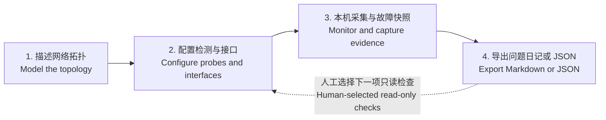

<div align="center">

# 🌐 MacNet Lab

**Visual Network Topology, Interface-Aware Monitoring & Portable Diagnostic Reports**<br />
**面向运维人员的 Windows / macOS 跨平台网络证据工作台**

[](https://github.com/lulouislu/macnet-lab/actions/workflows/checks.yml)
[](LICENSE)
[](docs/PLATFORM_SUPPORT.md)
[](#roadmap-en)
[](#reports-en)

[简体中文](#zh-cn) · [English](#english) · [使用手册](docs/USAGE_ZH.md) · [平台能力与验收](docs/PLATFORM_SUPPORT.md)

</div>

---


_Windows 原生运行的合成拓扑；没有配置真实网络目标，自动监控暂停。 / Native Windows run with a synthetic topology; no real network targets, monitoring paused._

<a id="zh-cn"></a>

## 🇨🇳 简体中文

### 📖 让 AI 先看懂网络，再定位问题

网络出问题时，单独一条 Ping 结果往往解释不了：MacBook 正接在哪个 AP 下？有线与 Wi-Fi 的出口是否不同？手机打印失败，是网络、Mac 的共享服务，还是 USB 打印机的问题？Minecraft 连不上，又是主机资源还是服务响应出了问题？

**MacNet Lab** 用“拼积木”的方式描述网络，把**用户声明的拓扑、当前接入位置、检测路径和故障证据**放在一起，导出为完整的问题日记（Markdown）或 JSON，由用户自行交给任何 AI 排查。软件不接入模型，不需要 API 密钥或 AI 登录。

- **现场维护**：Windows 笔记本或 MacBook 接入机房网线、任意 AP，从当前位置开展获授权的检测。
- **常驻监控**：常开电脑调度已启用的检测，记录故障与恢复。打印共享和 Minecraft 是可选场景，不是产品前提。

**单网即可使用，双网不是前提。** 支持描述单 AC 多 AP，也能表达同一台电脑的有线、Wi-Fi、USB 接口，以及打印共享和 Minecraft 服务。

> **当前版本：v0.1 开发预览。Windows 与 macOS 是同等目标平台。** 已实现 Windows 原生适配，不再要求预览启动参数；Linux 仍仅用于通用测试与预览。已验证的能力、当前限制和待做的真实多网卡/Wi-Fi/外设验收见[平台能力表](docs/PLATFORM_SUPPORT.md)。

### ✨ 核心特性

| 模块              | 当前能力                                                                                                                                |
| ----------------- | --------------------------------------------------------------------------------------------------------------------------------------- |
| 🧩 拓扑工作台     | 拖拽设备、接口级连线、多站点、JSON 导入导出、PNG 与浏览器打印；区分有线、Wi-Fi、USB、管理关系和服务依赖                                 |
| 📡 接口感知检测   | ICMP、TCP、DNS、HTTP(S)、显式代理与 Mihomo API；已实现 Windows / macOS IPv4 socket 接口绑定；Windows 绑定 ICMP 未支持，返回未知，不回退 |
| 🗺️ 当前接入位置   | 接口、地址与可读取的网关、DNS、Wi-Fi 信息；结合已配置 BSSID 清单关联 AP，不凭 SSID 猜完整网络                                           |
| 📦 故障黑匣子     | 连续失败阈值、重复事件合并、异常快照、恢复记录、接入变化与采集中断、证据导出                                                            |
| 🖨️ 主机服务       | macOS CUPS / IOUSB、Windows Spooler / CIM 只读采集；Minecraft Java / Bedrock 状态、主机及指定 PID 资源                                  |
| 🔐 凭据与只读 SSH | 系统凭据存储（Windows Credential Manager / macOS Keychain）、显式核实的主机公钥、固定命令组；不开放任意 Shell，不自动安装远程探针       |
| 📄 诊断导出       | 用户问题描述、拓扑、接入观测、全部保留的检测/故障/快照/事件、UTC 时间线；导出 Markdown 与版本化 JSON，由用户自行交给 AI                 |

**状态有边界：** 未知、暂停和监控中断不算正常；本机可达不等于其他终端或公网玩家可达。打印状态采集不等于手机发现或实际打印成功；Minecraft 状态不包含未采集的 TPS / MSPT。

### 🏗️ 四步工作流 / Architecture & Workflow


<details>
<summary>Mermaid 版本 / Editable Mermaid diagram</summary>



</details>

1. **拓扑建模**：拖入设备，连接具体接口，为服务补充名称和备注；拓扑是声明，不冒充自动发现结果。
2. **配置检测**：明确目标、端口、源接口、间隔与失败阈值。先手动运行，再按需启用自动监控。
3. **采集与留证**：由运行工作台的电脑发起检测；故障达到阈值后保存快照，SSH 补采需另行配置授权。
4. **导出排查资料**：在「诊断导出」填写症状、发生时间、影响范围、近期改动和尝试结果；预览后下载 Markdown 日记或 JSON，自行附给 AI。

### 🛠️ 快速开始

准备 **Windows 或 macOS、Python 3.11+、Node.js 22.12+（macOS 12 使用 22.x；Node 24 需 macOS 13.5+）和 Git**：

#### macOS

```bash
git clone https://github.com/lulouislu/macnet-lab.git
cd macnet-lab
bash scripts/install-macos.sh
bash scripts/start-macos.command
```

#### Windows（PowerShell / 终端）

```powershell
git clone https://github.com/lulouislu/macnet-lab.git
cd macnet-lab
python scripts/install.py
.\.venv\Scripts\macnet-lab.exe
```

Python 命令须指向已安装的 3.11+，也可用 `py -3` 替换 `python`。安装后可双击 `scripts/start-windows.cmd`。Windows 不需要 `--preview`，不需要修改系统执行策略或以管理员运行。

打开 **[http://127.0.0.1:8765](http://127.0.0.1:8765)**。首次启动的示例不启用网络检测；安装使用项目内 `.venv`，不需要 `sudo`，也不会自动添加登录项。首次构建需要联网下载依赖，日常运行不需要 Node.js。

选择设备 → 添加检测 → **运行一次** → 查看结果。需要持续采集时，再启用检测、保存并点击 **开始监控**。电脑休眠、退出登录或程序停止时，采集也会中断。

登录常驻、开发预览、备份、接口 DNS 配置与详细限制见 **[使用手册](docs/USAGE_ZH.md)**。当前仍从源码安装，不提供 Docker Compose、独立 Windows 安装包或签名的 `.app` / `.dmg`。

### 📄 导出文件，自己选择 AI

打开「诊断导出」→ 填写问题 → **生成并预览诊断报告** → 下载 `.md` 或 `.json` → 将文件附给你自己的 AI 对话。可复制随附的排查说明，无需在软件内登录或配置模型。

- **问题日记**：按 UTC 排列检测、故障开始/结束、快照和接入/采集中断事件，保留 ID 和已保存详情。
- **诊断 JSON**：`macnet.diagnostic-report` / `schema_version: 1`；包含结构化拓扑、源接口、统计、覆盖范围和问题描述，便于 AI 或其他工具读取。
- **完整范围**：导出该站点当前仍保留的全部记录，不受界面最近 300 条检测、300 个故障、100 条事件的列表限制。指定重点故障不会删除前后上下文。
- **本地处理**：生成与下载均不调用 AI、不上传报告。采集本身仍会访问你已配置的检测目标。
- **分享前检查**：常见凭据和私钥脱敏，URL 查询串/片段移除；IP、SSID、BSSID、主机名和备注保留。不要公开上传真实网络报告。

[合成示例日记](docs/examples/diagnostic.md) · [合成示例 JSON](docs/examples/diagnostic.json) · [导出格式说明](docs/DIAGNOSTIC_EXPORT.md)

已清理或从未采集的数据无法补回，采集时已截断的输出也无法还原；这些边界写在每份报告中。拓扑配置 JSON 仍用于导入/导出，与诊断报告分开。旧软件内 AI 接口返回 `410`，不再调用模型；现有网络和服务配置不变。

### 🗺️ 路线图

- [x] 拖拽拓扑、接口建模、多站点与配置存取。
- [x] 本机检测调度、检测记录、故障快照与恢复状态。
- [x] 打印 / USB、Minecraft、KWRT / Nikki 的限定只读采集适配。
- [x] 问题日记、完整保留范围的诊断 JSON、脱敏预览和可复制的 AI 排查说明。
- [x] Windows 原生网卡配置、Wi-Fi / 打印适配、IPv4 socket 接口绑定、安装和正常启动入口。
- [ ] Windows / macOS 的单 AC 多 AP、双接口不串路、Wi-Fi 漫游、外设和休眠恢复实机验收。
- [ ] 历史趋势图、IPv6 主动探测、控制器深度指标与受限 Minecraft 日志。
- [ ] 参数化受控修复、设备端 watchdog、回滚验证与审计。
- [ ] Windows 独立安装包、macOS 签名 / 公证应用包与架构兼容性确认。

自动下发远程探针、自动修复与回滚尚未实现；不承诺任何修复“绝不断联”。这些能力需要独立设计和故障注入演练，再逐项启用。

---

<a id="english"></a>

## 🇬🇧 English

### 📖 Understand the network before diagnosing it

A successful ping rarely tells the whole story. Which AP is the MacBook connected to? Are Ethernet and Wi-Fi using different paths? Is a printing failure caused by the network, the Mac's shared print service, or the USB printer? Is a Minecraft connection issue related to host resources or the service itself?

**MacNet Lab** combines a block-building topology editor with **declared network relationships, the current observation point, path-specific checks and incident evidence**. Export a Markdown problem diary or versioned JSON and give it to any AI yourself. No built-in model connection, AI login or API key is needed.

- **Field maintenance**: connect a Windows laptop or MacBook by Ethernet or through an AP and run authorized checks from that location.
- **Resident monitoring**: keep a computer online to schedule enabled checks and retain incident and recovery records.

**One network connection is enough.** Model a single-AC/multi-AP site or multiple interfaces on the same computer, including Ethernet, Wi-Fi, USB, printer sharing and a Minecraft server.

> **Status: v0.1 development preview. Windows and macOS are equal product targets.** Native Windows adapters and normal startup are implemented; Linux remains a generic test/preview platform. See the [platform matrix](docs/PLATFORM_SUPPORT.md) for validated behavior, unavailable features and outstanding hardware acceptance.

### ✨ Key features

| Module                    | Available implementation                                                                                                                                                                          |
| ------------------------- | ------------------------------------------------------------------------------------------------------------------------------------------------------------------------------------------------- |
| 🧩 Topology workbench     | Drag-and-drop devices, interface-level edges, multiple sites, JSON import/export, PNG export and browser printing; separate physical links from management and service dependencies               |
| 📡 Interface-aware checks | ICMP, TCP, DNS, HTTP(S), explicit proxies and the Mihomo API; Windows/macOS IPv4 socket interface binding; bound ICMP is unavailable on Windows and never falls back                              |
| 🗺️ Observation context    | Interfaces, addresses and available gateway, DNS and Wi-Fi information; match BSSIDs against a configured AP inventory rather than guessing from an SSID                                          |
| 📦 Incident evidence      | Consecutive-failure thresholds, deduplicated incidents, bounded snapshots, recovery records, access changes, collection gaps and evidence export                                                  |
| 🖨️ Host services          | Read-only macOS CUPS/IOUSB and Windows Spooler/CIM adapters; Minecraft Java/Bedrock status and host/per-PID resources                                                                             |
| 🔐 Credentials and SSH    | OS credential storage (Windows Credential Manager / macOS Keychain), explicitly verified host keys and fixed read-only command presets; no arbitrary shell or automatic remote-agent installation |
| 📄 Diagnostic export      | User symptoms, topology, observation context, all retained samples/incidents/evidence/events and a UTC timeline; Markdown and versioned JSON for manual AI handoff                                |

Unknown, paused and interrupted observations are not healthy results. Reachability from this computer does not establish reachability from another client or the public Internet. Print-service observations do not prove mobile discovery or a completed print job; Minecraft status does not include uncollected TPS/MSPT metrics.

### 🏗️ Four-step workflow

The diagram above follows the actual implementation:

1. **Model** devices, interfaces, physical links, management relationships and services. Keep declared topology separate from observations.
2. **Configure** targets, ports, source interfaces, intervals and failure thresholds. Run a manual check before enabling automatic monitoring.
3. **Observe** from the computer running the workbench. Capture incident snapshots; optional SSH evidence collection requires explicit credential and host-key setup.
4. **Export** a problem diary or JSON after previewing it. Attach the file to your own AI conversation and choose the next read-only check yourself.

<a id="quick-start-en"></a>

### 🛠️ Quick start

Requirements: **Windows or macOS, Python 3.11+, Node.js 22.12+ (use 22.x on macOS 12; Node 24 requires macOS 13.5+), and Git**.

#### macOS

```bash
git clone https://github.com/lulouislu/macnet-lab.git
cd macnet-lab
bash scripts/install-macos.sh
bash scripts/start-macos.command
```

#### Windows (PowerShell / terminal)

```powershell
git clone https://github.com/lulouislu/macnet-lab.git
cd macnet-lab
python scripts/install.py
.\.venv\Scripts\macnet-lab.exe
```

Use an installed Python 3.11+ (`py -3` is also supported). After installation, `scripts/start-windows.cmd` is a double-click launcher. Windows needs neither `--preview` nor an administrator account or execution-policy changes.

Open **[http://127.0.0.1:8765](http://127.0.0.1:8765)**. Example sites do not enable probes automatically. Installation uses a project-local `.venv`, requires no `sudo`, and does not register a login item. Building downloads dependencies; Node.js is not needed for daily operation afterward.

Select a device, add a check, and choose **Run once**. To collect continuously, enable the desired checks, save the site, then start monitoring. Collection stops when the computer sleeps, the user logs out or the application exits.

The **[Chinese usage guide](docs/USAGE_ZH.md)** covers optional login startup, development previews, backups and interface-specific DNS. Installation is source-based; standalone Windows installers, signed macOS packages and Docker Compose are not yet provided.

<a id="reports-en"></a>

### 📄 Export first, choose your own AI

Open **诊断导出 (Diagnostic export)**, describe the issue, preview the report, and download Markdown or JSON. Attach it to your own AI conversation; copy the included troubleshooting instructions if helpful. The application does not connect to a model or require AI credentials.

- **Markdown diary**: a UTC timeline of samples, incident starts/ends, snapshots and access/collection events, with record IDs and saved details.
- **Versioned JSON**: `macnet.diagnostic-report`, schema version 1, with topology, source interfaces, observations, user notes, counts and coverage limits.
- **All retained records**: no UI history/incident/event row caps. A focus incident marks priority without filtering out surrounding evidence.
- **Local generation**: no model request or report upload. Configured monitoring probes still contact their authorized targets.
- **Review before sharing**: common secrets and private keys are redacted; URL credentials, queries and fragments are removed. IPs, SSIDs, BSSIDs, hostnames and notes remain identifying.

[Markdown example](docs/examples/diagnostic.md) · [JSON example](docs/examples/diagnostic.json) · [Format reference](docs/DIAGNOSTIC_EXPORT.md). Examples contain synthetic data only.

Retention cleanup and capture-time truncation cannot be reversed; every report states these limits. Topology configuration export/import remains separate from diagnostic reports. Retired in-app AI endpoints return `410` and cannot invoke a model. No network, printing or Minecraft configuration is changed.

Active probes focus on IPv4. Bound hostname checks require an explicit IPv4 DNS server. SSH uses the system management path; interface-bound SSH returns unknown rather than falling back.

<a id="roadmap-en"></a>

### 🗺️ Roadmap

- [x] Modular topology editor, interface model, multiple sites and configuration persistence.
- [x] Local probe scheduling, result history, incident snapshots and recovery states.
- [x] Bounded read-only adapters for printing/USB, Minecraft and KWRT/Nikki.
- [x] Markdown problem diaries, complete retained-record JSON, redaction preview and copyable AI handoff instructions.
- [x] Native Windows network configuration, Wi-Fi/printing adapters, IPv4 socket binding, installation and normal startup.
- [ ] Physical Windows/macOS acceptance: AC/AP sites, independent network paths, roaming, peripherals and sleep/resume.
- [ ] History charts, active IPv6 probes, controller-specific metrics and limited Minecraft logs.
- [ ] Parameterized remediation, device-side watchdogs, rollback verification and audit trails.
- [ ] Standalone Windows installers, signed/notarized macOS packages and architecture validation.

Automatic remote-probe deployment and self-healing/rollback are not implemented. Remediation requires action-specific design and failure-injection tests before it can be enabled; uninterrupted connectivity is not guaranteed.

---

## 👨‍💻 Author & Contribution

**[lulouislu](https://github.com/lulouislu)** · [Issues](https://github.com/lulouislu/macnet-lab/issues) · [CI checks](https://github.com/lulouislu/macnet-lab/actions)

欢迎提交脱敏拓扑与复现步骤。 / Contributions with sanitized topologies and reproducible issue reports are welcome.

Released under the **[MIT License](LICENSE)**. Dependencies retain their respective licenses.
