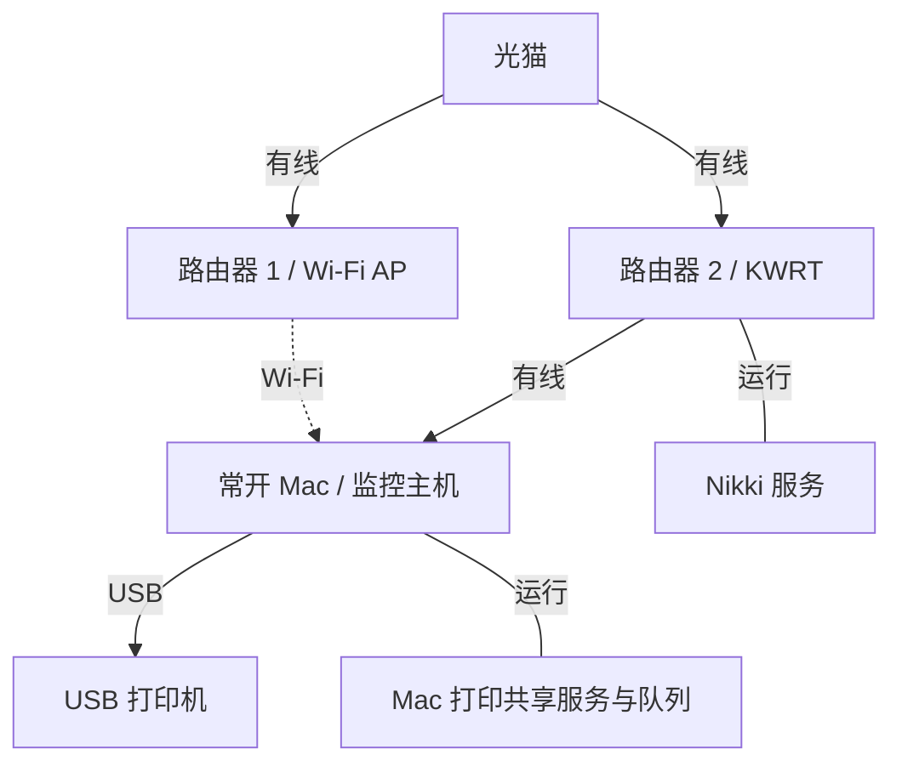

# MacNet Lab

**让 AI 看懂你的网络，再沿着证据找到问题。**

MacNet Lab 是一个面向局域网常开 Mac 的个人网络运维项目：用拖拽拓扑描述设备、接口和服务，同时观察有线与 Wi-Fi 两条路径，记录故障现场，帮助 AI 缩小排查范围。

> **项目状态：规划阶段。** 当前仓库包含项目说明与开发路线，尚无可运行程序。下文描述的是目标设计，功能进度以路线图中的勾选状态为准。

## 为什么做这个项目

网络出问题时，“能不能 Ping 通”往往不够。

- Mac 同时连接网线和 Wi-Fi，到底是哪条路径出了问题？
- 普通网页能打开，但经过 Nikki 的请求失败，应该检查哪里？
- 手机找不到共享打印机，是网络发现、Mac 的打印服务，还是 USB 连接出了问题？
- 故障恢复后，当时的日志和检测结果还能不能找到？

MacNet Lab 希望把这些线索放在一起：**拓扑说明环境，检测记录事实，黑匣子保留现场，AI 解释证据。**

## 从一张真实场景的示意图开始



Mac 是同一台设备，网线连接路由器 2，同时通过 Wi-Fi 连接路由器 1；打印机通过 USB 接入 Mac，由 Mac 提供打印共享。两条网络路径共用光猫，不代表两条完全独立的互联网线路。

图中的“运行”表示服务归属，不是物理连线。Nikki 是路由器 2 上的服务，不是所有流量都必经的一台设备。手机所在网络、网段、DHCP/DNS 角色及实际出口，需要在配置时明确。

## 拓扑不是装饰，是 AI 的网络上下文

画布是结构化网络模型的编辑入口。AI 需要读取的不只是一张图片，还包括：

1. **设备与接口**：同一台 Mac 的有线网卡、无线网卡和 USB 接口分别连接谁。
2. **连接类型**：有线（Ethernet）、Wi-Fi、USB，连线落到具体接口。
3. **网络角色与服务**：网关、DHCP、DNS、Nikki、打印共享，以及它们的归属。
4. **检测路径与证据**：从哪个接口发起检测、访问哪个目标、何时异常、有哪些日志。

用户声明的拓扑和实际检测到的状态分别保存。未知字段保留未知；发现两者不一致时提示差异，不自动改写网络关系。

## 计划提供的能力

### 拼积木描述网络

- 拖入网关、服务器、普通设备和外设，连接具体接口。
- 为设备挂载服务和检测项目。
- 区分拓扑编辑与监控查看，支持保存和导入导出。
- 保存拓扑、测试连接、启用监控分别操作；不因拖入设备自动安装探针或写入 SSH 公钥。

### 并行观察有线与 Wi-Fi

- 有线：连接状态、协商速率及可读取的链路指标。
- Wi-Fi：关联状态、信号质量及可读取的连接速率；字段按目标 macOS 版本与权限适配。
- 两条路径分别检测网关、延迟、丢包、DNS、HTTPS，以及配置的代理服务。
- 自动识别网卡，不写死 `en0`、`en1`；验证 DNS 与后续请求的实际检测路径。
- 某条路径断开时，不允许借另一条连接的成功结果将它标为正常；路径无法确认时显示未知。
- 按同一时间轴对比两条路径，标明 VPN、系统代理或隧道对检测的影响。

Wi-Fi 信号反映 Mac 所在位置及当前关联 AP 的情况；连接速率不等于实际下载速度，也不能代表其他房间或终端的体验。

### 沿服务链排查共享打印

```text
手机 → 所在网络 → Mac 打印共享服务 → 打印队列 → USB → 打印机
```

分别观察服务可达性、共享与队列状态、USB 设备识别和打印机报告的状态。USB 打印机不强制配置 IP，不用 Ping 判断在线；日常监控不自动发送测试打印任务。

手机端的发现与打印协议兼容性需要实际验证，不把“开启 Mac 打印共享”直接视为所有手机都可使用。

### 用黑匣子保留故障证据

- 故障前持续保留轻量指标与有大小限制的近期日志。
- 异常时补采已授权的只读快照，恢复后补采恢复信息。
- SSH 失败时保留已有证据，并记录采集失败的原因。
- 合并重复告警，记录故障开始、恢复和证据时间，设置数据保留与容量限制。
- 区分正常、异常、未知、暂停和监控中断；Mac 休眠或采集程序退出不记作全网断网。

### 让 AI 根据证据排障

选择一个事件，询问“刚才为什么断网”或“为什么手机打印不了”。AI 结合拓扑和所选证据给出：

- 观察到的事实与对应记录。
- 可能原因、疑似故障范围及判断依据。
- 还缺少什么证据，以及下一步的只读检查建议。

AI 首先只负责分析和受限的只读采集。AI 服务不可用时，本地监控、记录与回放继续工作。后续如接入多个提供商，日志外发目的地应明确展示，不静默切换。

## 拟采用的技术方案

| 模块 | 方案 | 用途 |
| --- | --- | --- |
| 界面 | Vue 3 + TypeScript + Vue Flow | 编辑拓扑、查看路径和事件 |
| 本地 API | Python + FastAPI | 配置、历史查询和实时状态推送 |
| 监控 | 独立的异步采集进程 | 双路径检测、事件判断、采集调度 |
| 远程只读采集 | AsyncSSH | 获取已授权设备的诊断信息 |
| 本地存储 | SQLite | 配置、检测结果、事件与受限快照 |
| macOS 适配 | 本机网络、Wi-Fi、USB 与打印状态接口 | 获取宿主机和外设状态 |
| AI 集成 | 独立适配层，优先评估 Codex App Server | 事件问答、只读工具与审批交互 |

部署目标是局域网内常开的 Mac，界面通过浏览器访问。具体最低 macOS 版本、Intel / Apple Silicon 支持和常驻方式，待首台目标机器验证后确定。当前尚无安装或启动命令。

## 开发路线

### 已完成的规划

- [x] 确定常开 Mac 为运行宿主机。
- [x] 确定有线与 Wi-Fi 并行监控需求。
- [x] 确定有线、Wi-Fi、USB 三类连接和接口级拓扑。
- [x] 确定 Mac 通过 USB 连接并共享打印机的场景。
- [x] 确定“网络建模 → 路径观测 → 故障证据 → AI 排障”的主线。

### M1 · 只读监控闭环

- [ ] 确认目标 Mac 的系统、接口与实际网络路径。
- [ ] 实现最小拓扑画布及配置存取，导出不含凭据。
- [ ] 实现有线与 Wi-Fi 的独立检测、状态展示和历史记录。
- [ ] 验收拔网线、断 Wi-Fi、检测不串路和监控中断场景。

### M2 · 故障黑匣子与打印状态

- [ ] 实现故障前记录、异常快照、恢复补采和事件时间轴。
- [ ] 接入限定范围的 KWRT / Nikki 只读信息采集。
- [ ] 接入 Mac 打印共享、队列和 USB 打印机状态。
- [ ] 验收 SSH 不通、重复告警及数据保留限制。

### M3 · AI 证据排障

- [ ] 将结构化拓扑、路径和事件证据交给 AI。
- [ ] 实现带证据引用的事件问答与受限只读工具。
- [ ] 实现外发前脱敏和明确的提供商选择。
- [ ] 验收 AI 离线时本地监控仍可使用。
- [ ] 支持拓扑图片与打印导出。

### M4 · 人工确认后的受控修复

- [ ] 从少量低风险、参数化动作开始，而不是开放任意 Shell。
- [ ] 为每个动作实现确认、备份、恢复机制、结果验证与审计。
- [ ] 在测试环境演练失败、SSH 中断及控制端退出后的处理。

首版不修改 LAN、DHCP、防火墙、管理地址或系统路由优先级，不做自动切网和 AI 循环修复。

## 安全与隐私设计

- 本地优先；不默认向公网开放管理接口。开放局域网访问时需配套认证与传输保护。
- 密码、SSH 私钥和 API 密钥不写入拓扑导出、日志或 Git 仓库；具体凭据存储方案随 macOS 适配确定。
- SSH 校验主机身份；远程采集限定命令、参数、执行时长与输出大小。
- 日志和设备输出作为不可信数据处理，不允许其中的文字改变 AI 权限或触发执行。
- 发给 AI 的资料限定在选定事件与必要上下文，并先移除凭据和敏感配置。
- 每次修改都需要明确授权，同一设备不并发执行多个变更。
- 恢复机制按具体动作设计并演练，不承诺统一的“45 秒必恢复”。

## 一起完善

欢迎通过 Issue 讨论具体场景、拓扑表达、检测方法和误报案例。提交问题时请使用脱敏示例，不上传真实密码、密钥、订阅地址或未经处理的设备日志。

下一步优先完成 **M1：在真实 Mac 上验证两条路径可以被独立、可信地观察**，再扩展黑匣子和 AI。

## 参考项目与文档

- [Vue Flow](https://vueflow.dev/)：拓扑画布组件。
- [FastAPI](https://fastapi.tiangolo.com/)：本地 API 框架。
- [AsyncSSH](https://asyncssh.readthedocs.io/)：异步 SSH 客户端。
- [Apple CoreWLAN](https://developer.apple.com/documentation/corewlan)：macOS Wi-Fi 信息接口。
- [Codex App Server](https://learn.chatgpt.com/docs/app-server)：应用内 Codex 集成方案。
