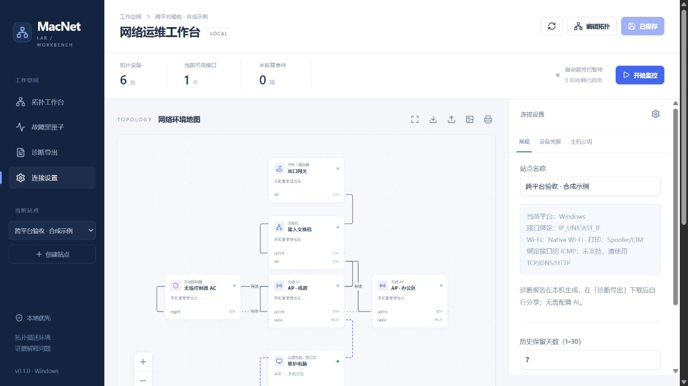

# Windows / macOS：同一套工作台，分别适配系统能力

MacNet Lab 面向现场运维人员，不要求 Mac、不要求双网，也不要求打印机或 Minecraft。Windows 与 macOS 是同等产品目标；项目名称与仓库地址暂保留，已有拓扑、脚本入口和数据继续可用。

共同流程：**描述拓扑 → 指定检测位置 → 记录故障证据 → 导出 Markdown / JSON → 用户自行交给 AI**。平台能力一并进入报告的 `current_observation.context.capabilities`，不支持的检测返回未知，不假装采集成功。

## 能力矩阵

| 能力                                    | Windows                                                                                              | macOS                                   |
| --------------------------------------- | ---------------------------------------------------------------------------------------------------- | --------------------------------------- |
| 拓扑、站点、历史、故障日记与 JSON       | 共用实现；正常启动无需 `--preview`                                                                   | 共用实现，保留原启动入口                |
| 主机资源、指定 PID、Minecraft 协议      | 共用 psutil 与只读协议                                                                               | 同左                                    |
| 接口类型、作用域网关和 IPv4 DNS         | NetAdapter / DNSClient / NetTCPIP 只读查询，JSON 输出不依赖中文/英文命令标签                         | networksetup / scutil / route           |
| 当前 Wi-Fi 关联                         | Native Wi-Fi：SSID、BSSID、速率、质量百分比及可读 RSSI/信道；不主动扫描                              | CoreWLAN                                |
| IPv4 TCP / UDP / DNS / HTTP(S) 接口绑定 | `IP_UNICAST_IF`，索引使用网络字节序；绑定失败不重试默认接口                                          | `IP_BOUND_IF`，保持原实现               |
| 显式代理 / Mihomo API 接口绑定          | 同一 Windows socket 选项；代理或控制 API 地址须为 IPv4，避免系统 DNS 串路                            | 同一 macOS socket 选项，保留原要求      |
| ICMP Ping                               | 系统默认路径可用；指定接口时返回未知，改用 TCP/DNS/HTTP                                              | 默认路径及 `ping -b`                    |
| 打印与 USB                              | Spooler 状态、打印机、队列数量、USB 打印设备；部分查询失败单独标记，不读取任务标题/所有者，不保存 USB 序列号 | CUPS / IOUSB；不发送打印任务            |
| SSH 固定命令组                          | 共用 AsyncSSH；系统管理路径，不支持接口绑定                                                          | 同左                                    |
| 凭据                                    | keyring 的 Windows Credential Manager 后端；不降级明文                                               | keyring 的 macOS Keychain 后端          |
| 登录后常驻                              | 暂无自动注册入口，前台运行                                                                           | 可选用户 LaunchAgent；仍待 Mac 实机验收 |
| 原生发行包                              | Windows x64 便携 ZIP（内含 `.exe` 与运行依赖），无需安装 Python / Node；未签名；暂无 `.msi`          | 暂无签名 / 公证 `.app` / `.dmg`         |

Wi-Fi 读取受连接状态、驱动和系统隐私权限影响；权限不足时保留未知，不自动修改位置权限，也不把质量百分比冒充 RSSI。IPv6 地址可展示，IPv6 主动探测尚未实现。

Windows 的实现依据：[IPv4 socket 选项](https://learn.microsoft.com/en-us/windows/win32/winsock/ipproto-ip-socket-options)、[接口别名转换](https://learn.microsoft.com/en-us/windows/win32/api/netioapi/nf-netioapi-convertinterfacealiastoluid)、[当前无线关联查询](https://learn.microsoft.com/en-us/windows/win32/api/wlanapi/nf-wlanapi-wlanqueryinterface)。

## 当前实测与发布门槛

目标环境为 Windows 10/11 与 macOS（包括用户的 12.7.6 兼容性目标）。实际依赖版本须匹配系统，macOS 12 构建前端使用 Node 22.x，至少 22.12。Linux 只做通用测试与显式开发预览。

本次 Windows 11 实测已取得：物理有线/WLAN/虚拟网卡分类、接口索引、接口级网关与 DNS、Spooler 状态和打印机枚举。原生 socket 的出站索引读回正确；回环上的指定接口 TCP/HTTP、UDP 传输通过。无线接口未连接且当前无线关联查询返回权限受限，因此未验证真实 SSID/BSSID、漫游或信号变化；没有 USB 打印机，不以空列表当作 USB 硬件通过。

[Windows 便携版](WINDOWS_PORTABLE.md)独立验收覆盖解压包启动、界面静态资源、本机资源检测、Markdown / JSON 导出、重复启动、不同数据目录拒绝、正常退出及重开保留数据。Windows 10 与 ARM64 尚未实机验证；当前包只面向 x64。

这些结果不替代以下硬件门槛：

- Windows 和 macOS：只接一条网线、只接 Wi-Fi，均能完成检测与诊断导出。
- 双接口接入可区分的测试路径，核对 DNS/TCP/HTTP/代理出口；经用户确认后断开指定接口，不能借另一接口变绿。
- 已连接 Wi-Fi 下核对 SSID、BSSID、RSSI/速率；无权限时解释缺失，获得许可后再验收；AP 漫游不改写声明拓扑。
- 真实 USB 打印机、已有打印共享与 Minecraft 服务：只读查询不干扰运行；手机发现与真正打印需单独获授权验证。
- 同一拓扑和问题在两种系统均能保存/重开、导出相同版本的诊断结构；记录真实平台、源接口及能力限制。
- Windows 凭据存储及 macOS Keychain 真实账号测试在用户授权下执行，不用现有私人密钥做自动测试。
- 休眠、换网和程序重启保留数据缺口，不误记恢复。[Mac 详细清单](MAC_ACCEPTANCE.md)继续适用。

每项记录通过 / 失败 / 未执行，附版本、配置、预期、实际和脱敏证据。只把已经完成的项目标为实机通过。
