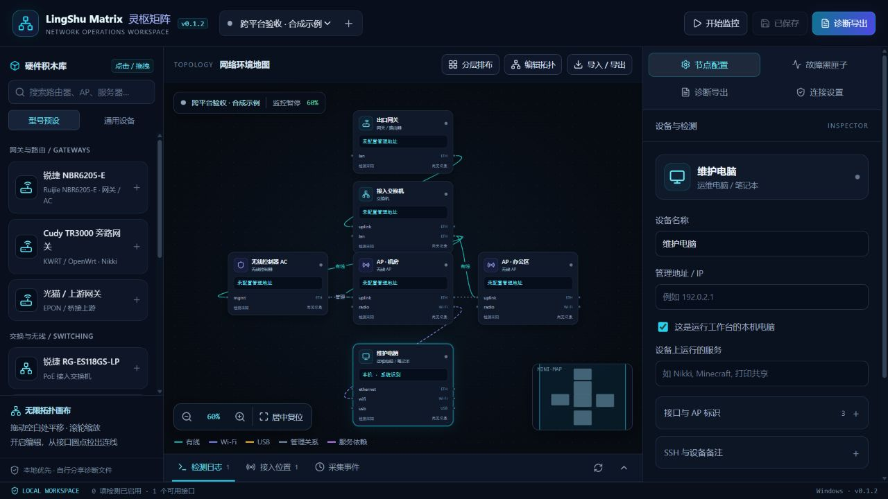

# 灵枢 · LingShu Matrix

**让 AI 看懂你的网络，再沿着证据找到问题。**

面向 Windows / macOS 的本地网络运维工作台：用拓扑描述设备、接口与服务，把当前接入位置、检测记录和故障现场一起交给 AI 分析。

Windows 笔记本或 MacBook 接一根机房网线、连任意一个 AP，或常开 Mac 同时使用有线与 Wi-Fi，都可以是观测入口。**双网不是使用前提。**

> **v0.1 开发预览**：已有可运行程序、自动化测试和安装脚本。Windows 已有原生适配与正常启动入口；平台实测情况见[能力与验收](PLATFORM_SUPPORT.md)。真实多网卡隔离、Wi-Fi 漫游、外设及 macOS 验收仍待完成。当前没有签名的 `.app` / `.dmg` 安装包。



_图为 Windows 原生运行；没有配置真实网络目标，自动监控暂停。_

## 先把一项检测跑起来

### Windows 便携版：无需安装开发环境

完整解压 Windows x64 应用 ZIP，双击 `LingShuMatrix.exe`，保留 `_internal` 文件夹。浏览器就绪后自动打开；关闭网页不停止采集。用「连接设置 → 常规 → 退出工作台」正常退出，或在启动窗口按 `Ctrl+C`。重复打开仅复用同一数据目录的实例；其他端口占用会提示冲突，不接管或停止其他程序。

[便携版下载、数据位置、更新与构建](WINDOWS_PORTABLE.md)。当前为未签名开发预览，不要求 Python、Node.js 或管理员权限。

### 在 Mac 上从源码安装

准备 Python 3.11+、Node.js 22.12+（macOS 12 选 22.x；Node 24 要求 macOS 13.5+）和 Git，然后在终端执行：

```bash
git clone https://github.com/lulouislu/lingshu-matrix.git
cd lingshu-matrix
bash scripts/install-macos.sh
bash scripts/start-macos.command
```

### 在 Windows 上从源码安装

确保终端中的 `python` 是 3.11+，并已安装 Node.js 22.12+ 和 Git：

```powershell
git clone https://github.com/lulouislu/lingshu-matrix.git
cd lingshu-matrix
python scripts/install.py
.\.venv\Scripts\lingshu-matrix.exe
```

也可用 `py -3 scripts/install.py`。安装后双击 `scripts/start-windows.cmd` 可启动。不需要 `--preview`、管理员权限或修改执行策略。

安装使用项目内 `.venv`，不需要 `sudo`。首次构建需要下载 npm / PyPI 依赖；之后日常运行不需要 Node.js。

打开 [本地工作台](http://127.0.0.1:8765)。首次启动的示例**不会探测你的网络**。

1. 顶部选择站点或点击「+」创建空白站点；左侧「型号预设 / 通用设备」可点击或拖入画布。开启「编辑拓扑」后，从接口圆点拉线。
2. 点击设备填写管理地址、服务、接口信息；当前电脑勾选「这是运行工作台的本机电脑」。
3. 添加一项检测，先点「运行一次」，在「结果详情」查看指标与实际配置的检测路径。
4. 要持续采集时，再勾选检测的「自动检测」、保存，并点击「开始监控」。
5. 连续失败达到阈值后，在「故障黑匣子」查看现场证据，再去「诊断导出」生成报告，自行交给 AI。

### 新版三栏工作台

- **左侧设备库**：型号预设沿用用户提供的界面设计，也可选择通用路由器、AC、AP、电脑、服务器或打印机。预设只填名称、类型与型号备注；管理地址、凭据和检测需自行配置，不会自动发现或安装远程探针。
- **中央无限画布**：拖动空白处平移、滚轮缩放；「居中复位」显示全部节点，缩略图可点击定位。「分层排布」只调整草稿坐标，不改动实际网络或设备连线，点击「保存修改」后持久保存。
- **右侧工具面板**：节点配置、故障黑匣子、诊断导出、连接设置。数据和功能沿用原版；不提供模拟的 AI 自愈、SSH 认证成功或故障注入按钮。
- **底部记录抽屉**：点击「检测日志」「接入位置」「采集事件」展开。画布卡片的状态、CPU / MEM 和耗时来自检测记录；尚无数据时显示未知，记录时间始终保留。

拓扑 JSON 用于重新搭建站点；问题日记 / 诊断 JSON 还包含保留范围内的检测、故障和现场证据。排查问题时优先使用「诊断导出」。

停止前台程序：在启动终端按 `Ctrl+C`；Windows 也可在「连接设置 → 常规 → 退出工作台」确认。退出前保存拓扑，关闭浏览器不等于停止采集。macOS 登录常驻须用下述 `login-item.py remove`；外部 ASGI 服务仍由原服务管理器停止。

### 可选：macOS 登录后常驻

先停止手动启动的实例，再执行：

```bash
.venv/bin/python scripts/login-item.py install
.venv/bin/python scripts/login-item.py status
# 停止常驻并取消登录启动，保留数据库和钥匙串：
.venv/bin/python scripts/login-item.py remove
```

这是当前用户的 LaunchAgent，不是 root 服务。只有用户登录且 Mac 醒着时才能采集；迁移项目目录后需要重新安装登录项。此入口已实现，等待真实 macOS 验收。

## 从 MacNet Lab 升级

灵枢 · LingShu Matrix v0.1.1 沿用原版数据。先退出旧程序并备份完整数据目录，再安装或解压新版本，使用原来的 `--data-dir` 参数启动；不要仅因更名创建或移动数据库。

- 新命令为 `lingshu-matrix`，旧命令 `macnet-lab` 和原有 macOS / Windows 启动脚本继续可用。Python 分发名 `macnet-lab` 与导入路径 `macnet` 保留兼容。
- 新便携包使用 `LingShuMatrix.exe`，同目录保留 `MacNetLab.exe` 兼容入口；请将自己的快捷方式指向新版解压目录，保留原数据目录参数。
- 默认目录仍为 Windows 的 `%LOCALAPPDATA%\MacNetLab` 或 macOS 的 `~/Library/Application Support/MacNetLab`；`MACNET_DATA_DIR`、系统凭据服务名 `MacNetLab`、已安装的 LaunchAgent 标识不变，无需重新录入凭据。
- 诊断 JSON 仍使用 `macnet.diagnostic-report` v1，拓扑 ID、HTTP 会话协议和数据库结构不变；新报告的 `application.name` 使用新名称。原有拓扑仍可导入，历史诊断报告无需改写。

## 用拓扑说明环境，不让 AI 猜接线

内置两类示例，也支持空白站点：

```text
单 AC / 多 AP：
网关 ── 交换机 ── AC、AP 1、AP 2
AC  ··· 管理关系 ··· AP 1 / AP 2
AP 1 ── Wi-Fi ── Windows 笔记本 / MacBook

家庭实验室（两处 Mac 是同一台）：
光猫 ── 路由器 1 ── Wi-Fi ── Mac
     └─ KWRT / Nikki ── 有线 ── Mac ── USB ── 打印机
                                  └─ 运行：打印共享、Minecraft
```

- **有线、Wi-Fi、USB** 连到具体接口；**管理关系、服务依赖** 单独表达。
- AP 可以配置多个 BSSID。读取到当前 BSSID 后，只有唯一匹配才关联 AP；不凭 SSID 猜设备。
- 服务名称、设备备注用于补充 VLAN、DHCP / DNS 角色、部署位置等上下文；这些角色目前还不是独立的结构化配置项。
- 声明的拓扑与实际观测分开。看不到管理网，不会自动改 VLAN、路由或访问控制。

## 当前可以做什么

| 能力         | 当前实现与边界                                                                                                                      |
| ------------ | ----------------------------------------------------------------------------------------------------------------------------------- |
| 拓扑编辑     | 拖拽设备、接口连线、多站点、乐观锁保存、JSON 导入导出、PNG 与浏览器打印                                                             |
| 当前接入     | 接口、IPv4 / IPv6 地址、可用速率与计数器；macOS 与 Windows 分别读取接口级网关、DNS 及可用的 Wi-Fi 信息                              |
| 网络检测     | ICMP、TCP、DNS、HTTP(S)、显式 HTTP / SOCKS 代理、Mihomo 控制 API                                                                    |
| 路径隔离     | Windows / macOS IPv4 socket 绑定接口；HTTP 绑定 socket 并显式解析；绑定失败不回退。默认路径会明确标为 `system`                      |
| 故障黑匣子   | 连续失败阈值、重复事件合并、异常快照、连续两次成功确认恢复、手动补采、证据导出                                                      |
| 中断识别     | 接口 / 地址 / 网关 / BSSID 变化、程序重启及超过 60 秒的调度缺口会中断旧事件，不伪装成恢复                                           |
| 本机打印     | macOS 读取 CUPS / IOUSB；Windows 读取 Spooler、打印机、队列数量与 USB 打印设备；不发测试打印任务，不自动把普通打印共享变成 AirPrint |
| Minecraft    | Java / Bedrock 只读状态协议，版本、人数、请求耗时；本机资源可附加指定 PID 的内存与累计 CPU 时间                                     |
| KWRT / Nikki | 已校验主机公钥的 SSH 固定只读命令组；Mihomo API 状态与显式代理上网分别检测                                                          |
| 诊断导出     | 完整保留范围的 Markdown 日记与 JSON、用户问题描述、UTC 时间线及 AI 排查说明；本机生成，不接入 AI                                    |

### 怎样分别检测有线与 Wi-Fi

为同一目标创建两项检测，各自选择真实的采集源接口。绑定接口访问域名时，填写该路径的 **IPv4 DNS 服务器**，防止借另一接口解析。

现场维护中不常用的第二接口，取消「此接口必须在线」：它断开时记为暂停，而不是故障。接口名称从系统读取，不写死 `en0` / `en1`。

Windows 绑定接口的 ICMP 暂未支持，显示未知且不发送默认路径 Ping；改用绑定的 TCP / DNS / HTTP。macOS 保留 `ping -b`。

当前主动检测以 **IPv4** 为主；IPv6 主动探测未实现。SSH 只读采集使用系统管理路径，配置接口绑定时会显示未知而不执行。VPN / 透明代理的端到端实际出口、其他 AP 的覆盖和其他玩家的公网可达性，需要对应位置的额外证据。

### 打印和 Minecraft 的判断范围

新建打印检测时，界面默认设为 15 秒超时，给 Windows PowerShell / CIM 冷启动留出时间。原有检测保留自己的超时设置；Windows 打印查询超时显示未知，不直接判定服务故障。

USB 打印机无需填写 IP。打印服务（CUPS / Spooler）可查询、USB 已枚举、手机可发现、实际打印成功是不同事实；本工具目前覆盖前两类本机只读信息。

Minecraft 协议响应与进程资源分开采集。服务进程 PID 需要手动维护；PID 重用、重启后请核对进程名和创建时间。当前不读世界存档、聊天或完整服务器日志，也不报告未采集的 TPS / MSPT。

## 导出问题日记，再交给 AI

1. 保存当前拓扑，打开「诊断导出」。
2. 填写问题描述、发生时间（注明时区）、影响范围、近期改动及已尝试操作。没有信息可以留空，不替你编造。
3. 可指定重点故障。报告仍包含该站点全部保留的记录，方便比较故障前后。
4. 点击「生成并预览诊断报告」。下载问题日记 `.md` 或诊断 `.json`；两个文件来自同一次数据快照。
5. 人工检查报告，附到自己选择的 AI 对话，再粘贴「复制给 AI 的排查说明」中的内容。

软件不登录 AI、不保存 AI 密钥、不自动上传报告。表单描述仅随本次报告保存，切站点或刷新页面前请下载；已有报告在生成时冻结，之后的新检测需重新生成才能加入。

报告不是界面的最近记录列表：它在一次数据库读快照中取出站点全部仍保留的检测、故障、快照与事件，按 UTC 排列。已清理记录、未采集信息与采集时截断的输出无法恢复，具体范围见报告的 coverage。当前观测不冒充故障当时观测；新快照保存当时拓扑，旧快照可能缺少该信息。

常见凭据字段、私钥和 URL 用户信息/查询串/片段会处理；IP、SSID、BSSID、设备名称、主机名和备注保留，方便理解网络关系。规则脱敏不能替代人工检查，不要在自由文本里填写密码，也不要公开上传真实报告。

[导出格式与 API](DIAGNOSTIC_EXPORT.md) · [合成示例日记](examples/diagnostic.md) · [合成示例 JSON](examples/diagnostic.json)

## 数据、安全与恢复

- 只监听 `127.0.0.1:8765`，校验 Host / Origin，并使用本机会话 Cookie 和写请求确认头；不提供局域网或公网管理模式。
- 默认数据目录：macOS 为 `~/Library/Application Support/MacNetLab`，Windows 为 `%LOCALAPPDATA%\MacNetLab`。旧 Windows 预览若在原默认目录已有数据库且新目录没有，继续使用旧目录，不自动搬动或覆盖。可用 `--data-dir /path/to/data` 指定。配置、历史和快照在 SQLite，设备凭据在系统凭据存储，已核实公钥在独立 `known_hosts`。
- SSH 不自动信任新主机，不使用 SSH agent 或任意 Shell 输入。先经可信渠道核实公钥，再在设置粘贴完整 OpenSSH 记录。保存会替换本工具原有记录。
- 默认保留 7 天，可设置 1–30 天；另有样本 / 证据行数上限、单条输出上限与数据盘低空间暂停。SQLite 主库设置约 512 MiB 页面上限；WAL 不计入这个上限。
- 拓扑配置 JSON 导出移除凭据引用并禁用检测，导入创建新站点；诊断 JSON 保留检测当时的配置状态，只用于阅读分析，不用于导入。**IP、BSSID 和备注保留**；截图和证据导出也需要人工检查后再分享。
- 完整备份：停止采集程序，备份整个数据目录；钥匙串单独保留。拓扑 JSON 只用于交换配置，不是历史记录备份。

首版只读，不修改 LAN、DHCP、防火墙、系统路由、打印配置、Minecraft 存档或玩家权限。**受控修复、设备端 watchdog 和回滚审计仍未实现**，不会把 `sleep 45` 当作可靠恢复承诺。

## 开发与验证

Vue 3 + TypeScript + Vue Flow；FastAPI + asyncio；SQLite；AsyncSSH；CoreWLAN / Windows Native Wi-Fi、NetAdapter / CIM / psutil / keyring。

macOS / Linux 开发测试：

```bash
python3 -m venv .venv
npm --prefix frontend ci
npm --prefix frontend test
npm --prefix frontend run build
.venv/bin/python -m pip install '.[dev]'
.venv/bin/python -m pytest -q
```

Windows 开发测试使用 `.venv\Scripts\python.exe`；正常启动无需预览参数：

```powershell
.venv\Scripts\python.exe -m macnet.cli --data-dir .\data
```

Linux 等其他系统仍需显式 `--preview`，仅验证通用能力，不模拟 Windows/macOS 专属字段。

生产前端输出到 `macnet/static`，不提交生成文件。发布 Python 包前必须先构建前端。`python -m build` 打包的 wheel 包含已构建界面，源码仓库直接 `pip install .` 而未构建前端时会提示 503。

提交会触发 macOS / Linux / Windows CI；CI 结果看 [Actions](https://github.com/lulouislu/lingshu-matrix/actions)，不把配置了 CI 当作已通过真实设备验收。

## 接下来完成什么

- [x] 拓扑 → 只读检测 → 故障快照 → 诊断导出闭环。
- [x] 打印、USB、Minecraft、KWRT / Nikki 的限定采集适配与安装入口。
- [x] 问题日记、完整保留范围的诊断 JSON、脱敏预览和手动 AI 交接。
- [x] Windows 原生配置 / Wi-Fi / 打印适配和 IPv4 socket 接口绑定。
- [x] Windows x64 便携 ZIP、单实例识别、就绪后打开网页与正常退出。
- [ ] [双平台实机验收](PLATFORM_SUPPORT.md)及[Mac 清单](MAC_ACCEPTANCE.md)：单有线、单 Wi-Fi、单 AC 多 AP、双接口不串路、休眠恢复、打印与钥匙串。
- [ ] 图表化历史、IPv6 主动探测、设备控制器深度指标、受限 Minecraft 日志。
- [ ] 参数化受控修复：逐动作确认、设备端恢复、验证与审计，通过故障注入演练后再启用。
- [ ] Windows 独立安装包、macOS 签名 / 公证应用包与架构兼容性确认。

欢迎用脱敏拓扑与复现步骤提交 Issue。代码采用 [MIT License](../LICENSE)；依赖保留各自许可证。
